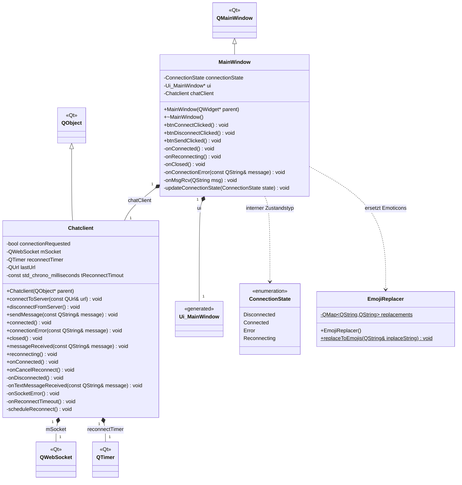

# Klassendiagramm des RPI-ChatClients

Das Diagramm basiert auf den Klassen in `mainwindow.h`, `chatclient.h` und
`emojireplacer.h`. Einzelne UI-Widgets und Layouts sind zur besseren Übersicht
ausgelassen. Qt-Klassen sind ohne ihre eigenen Methoden dargestellt.

`+` kennzeichnet öffentliche und `-` private Elemente. Unterstrichene Elemente
sind statisch. Ein ausgefüllter Diamant steht für Komposition (Besitz),
ein Dreieck für Vererbung und ein gestrichelter Pfeil für eine Abhängigkeit.
`Ui_MainWindow` bezeichnet die generierte Klasse `Ui::MainWindow`;
`std_chrono_milliseconds` steht für `std::chrono::milliseconds`.
`ConnectionState` ist ein privater Enum-Typ von `MainWindow`.
Die konstante, statische Ersetzungstabelle gehört zu `EmojiReplacer`.

## Qt-Signale und Slots

Die folgenden Signale von `Chatclient` sind mit Slots von `MainWindow` verbunden:

| Signal von Chatclient | Slot von MainWindow |
| --- | --- |
| `connected()` | `onConnected()` |
| `closed()` | `onClosed()` |
| `connectionError(const QString&)` | `onConnectionError(const QString&)` |
| `messageReceived(const QString&)` | `onMsgRcv(QString)` |
| `reconnecting()` | `onReconnecting()` |

Die drei öffentlichen `btn…Clicked()`-Methoden von `MainWindow` sind Slots.
Seine privaten `on…`-Methoden sind ebenfalls Slots. Bei `Chatclient` sind
`onConnected()` und `onCancelReconnect()` öffentliche Slots, die übrigen
`on…`-Methoden private Slots. Der WebSocket meldet Verbindung, Trennung,
Empfang und Fehler an diese Slots; der Timer ruft bei Ablauf
`onReconnectTimeout()` auf. Die Reconnect-Verzögerung beträgt 500 ms.
